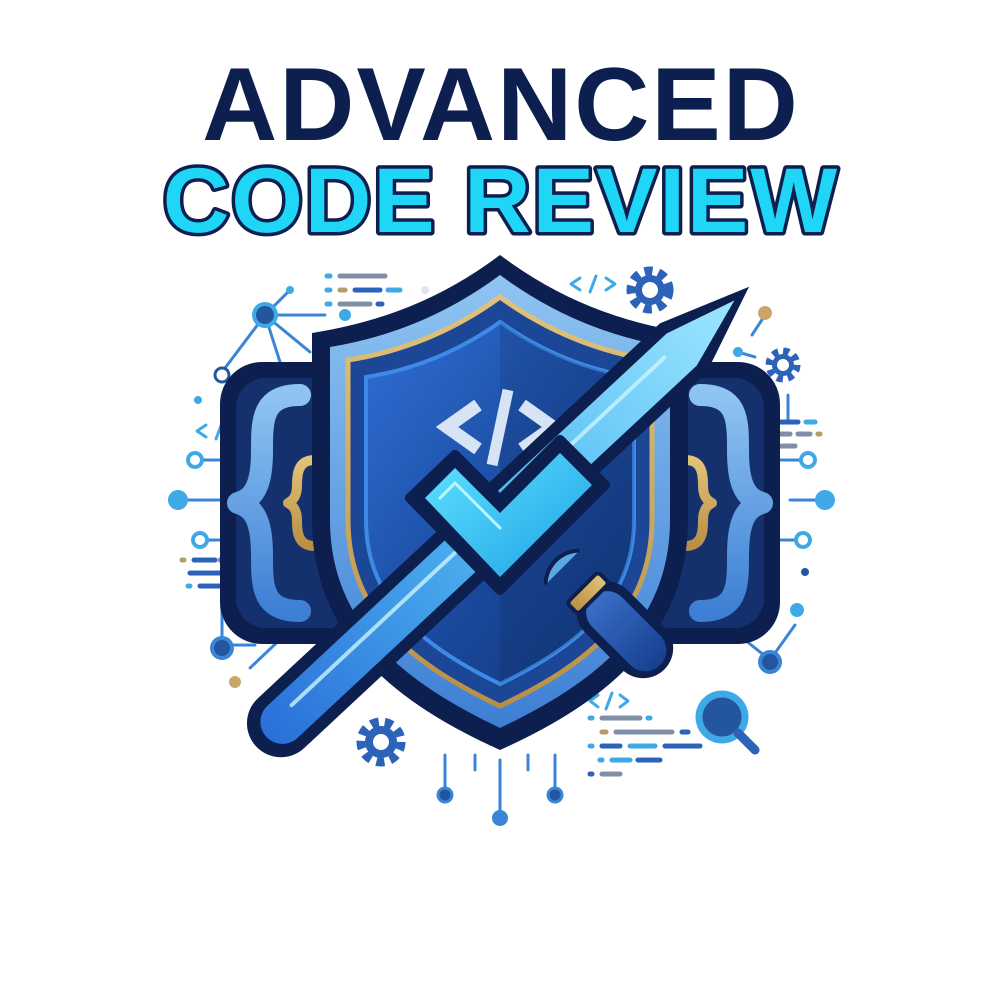

  

# Advanced Code Review

Framework open source para revisar de forma estática repositorios de hackathons, sin importar el lenguaje en que estén programados.

> **Estado:** especificación. La implementación aún no existe; el diseño completo está en [SPEC.md](SPEC.md).

## Qué evalúa

| Criterio | Qué se revisa |
| --- | --- |
| Factibilidad técnica | Lenguajes, tamaño, arquitectura y dependencias |
| Calidad del código | Hallazgos de linters, mantenibilidad |
| Seguridad | Código inseguro (CWE / OWASP Top 10), dependencias con CVE, secretos expuestos |
| Integración responsable de IA | Secretos expuestos, datos enviados al proveedor de IA, filtros y supervisión humana |
| Plagio | Código copiado de proyectos públicos, similitud entre equipos e ideas ya existentes en la web |

El análisis dinámico (ejecutar la app) queda fuera de este proyecto.

## Stack

Todo el stack es open source y gratuito.

| Herramienta | Función |
| --- | --- |
| [scc](https://github.com/boyter/scc) | Detecta lenguajes y tamaño de cada repositorio |
| [MegaLinter](https://megalinter.io/) | Calidad de código, Semgrep, Betterleaks (secretos) y Trivy (dependencias) en una sola pasada |
| [SCANOSS](https://osskb.org/) | Plagio de código open source conocido (envía solo huellas, no el código) |
| [Dolos](https://dolos.ugent.be/) | Similitud de código entre equipos |
| Grafana + Loki + Prometheus + Infinity | Dashboard local de 6 páginas con navbar: resumen, equipo, calidad, seguridad, plagio y calificación |
| [md-to-pdf](https://github.com/simonhaenisch/md-to-pdf) | Exporta el reporte de cada equipo a PDF; los botones del dashboard lo descargan |
| Claude Code | Revisión asistida y búsqueda de plagio de ideas en la web |

Claude Code requiere una suscripción propia.

## Flujo

1. Clonar cada repositorio una vez, en solo lectura.
2. Reconocer lenguaje y tamaño con scc.
3. Correr MegaLinter (un contenedor) y enviar los resultados a Grafana.
4. Correr SCANOSS por repositorio y Dolos sobre todos los repositorios juntos.
5. Hacer la revisión asistida con Claude Code a partir de los reportes generados.
6. Entregar el dashboard y un reporte Markdown por equipo.

## Privacidad

El código revisado pertenece a los equipos participantes:

- No se ejecuta ni se modifica.
- Las carpetas `repos/` y `reports/` están en `.gitignore` y nunca deben subirse a este repositorio.
- El dashboard corre solo en local; se comparte mediante reportes exportados (PDF, Markdown y ZIP).

## Licencia

[MIT](LICENSE)
